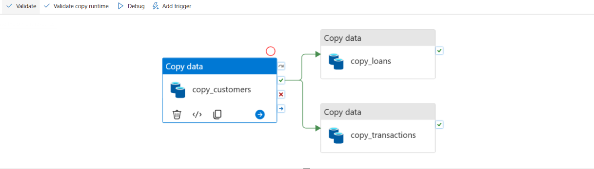

# Bank Risk Data Platform

An Azure data platform for a synthetic bank. It loads customer, loan and transaction data from a data lake into Azure SQL Database, ready for credit-risk and anti-money-laundering (AML) analysis.

**Status:** The Azure data engineering part is complete. The credit-risk model is in progress.

All data is synthetic and generated in Python. No real customer data is used.

## Results

- **20,000 customers, 12,000 loans (732 defaults, 6.1%) and 801,528 transactions** loaded into Azure SQL Database. Row counts match the source files exactly.
- **Safe to rerun:** three pipeline runs, no duplicate rows.
- **Data-quality checks passed:** no invalid loan values, no out-of-range ages or incomes, and no loans or transactions without a customer.
- **No stored keys or passwords:** every connection uses a managed identity or Microsoft Entra ID.

## Architecture

```
Python notebook (synthetic data, fixed seed)
        |  CSV files
        v
Azure Data Lake Storage Gen2 (raw container)
        |  Azure Data Factory, managed identity, read-only
        v
Azure SQL Database (Entra-only, primary and foreign keys)
        |
        v
Credit-risk model and AML rules (in progress)
```



## Design choices

**Realistic synthetic data**
- Mortgages are 2 to 5 times yearly income, following the Norwegian lending rule.
- Defaults depend on payment-to-income, employment type, age and loan type, plus noise, so a model has a real but imperfect signal.
- Two money-laundering patterns are planted: structuring (40 customers) and pass-through accounts (30 customers). The answer key is never committed, so detection rules can be scored fairly.

**Security**
- Data Factory signs in with its system-assigned managed identity.
- On the storage account it has only the Storage Blob Data Reader role.
- In the database it has only `db_datareader` and `db_datawriter`. It can load rows but cannot create or drop tables.
- The SQL server uses Microsoft Entra-only authentication, so no SQL passwords exist.

**Pipeline**
- `copy_customers` runs first. Only if it succeeds do `copy_loans` and `copy_transactions` run, in parallel, because of the foreign keys.
- A pre-copy script empties the tables in reverse foreign-key order, so the pipeline is idempotent.
- Two retries with a 60-second interval handle the serverless database waking up from pause.

**Schema changes as numbered scripts**
- When Data Factory could not convert the text `0` into a `BIT` column, I kept the raw file unchanged and changed the target column to `TINYINT` in a new script (`sql/03_loans_defaulted_to_tinyint.sql`).

**Reproducibility and cost**
- A fixed random seed rebuilds the full data. Only 1,000-row samples are in Git.
- The database uses the Azure SQL free offer with overage billing disabled. It is in Sweden Central because the free subscription had no SQL capacity in Norway East.

## Limits

- The data is synthetic, so a model will likely score better than on real bank data.
- The Azure resources ran on the free credit and are now switched off. Screenshots and notes are in [`docs/azure/`](docs/azure/README.md).
- Shared-key access on the storage account was left at the Azure default. The pipeline never used it; in production I would disable it.
- The pipeline runs manually; there is no scheduled trigger.

## Next

- [ ] Probability-of-default model, explained with SHAP
- [ ] Expected loss per loan (PD × LGD × EAD)
- [ ] AML rules in SQL, scored against the planted patterns
- [ ] Power BI report for credit risk and suspicious activity

## Repository

- `01_generate_bank_data.ipynb`: generates the synthetic data
- `data/sample/`: first 1,000 rows of each table
- `sql/`: numbered SQL scripts (tables, Data Factory user, schema change, row counts, data-quality checks)
- `adf/`: Data Factory pipeline definition (JSON)
- `docs/azure/`: screenshots and notes of the Azure setup

## Tools

Python (pandas, NumPy), Jupyter, Azure Data Lake Storage Gen2, Azure Data Factory, Azure SQL Database, T-SQL, Microsoft Entra ID (managed identity), Git, GitHub
