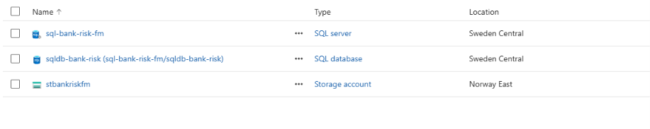
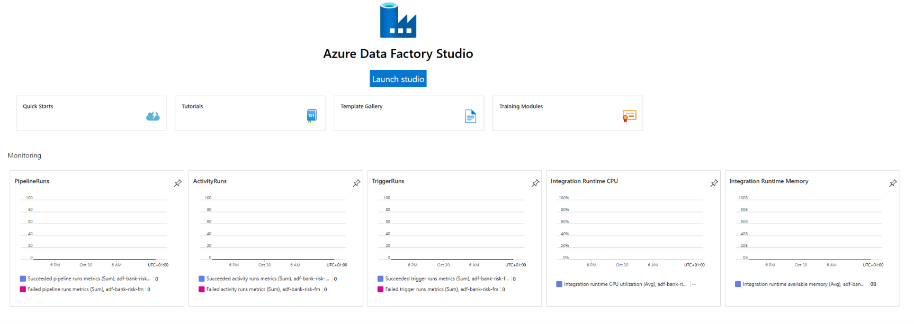

# Azure setup

This project runs on the Azure free credit, which ends in early November 2026. After that the resources are switched off, so I keep screenshots and short notes here.

## Day 1 (28 October 2026)

### Resource group

A separate resource group, `rg-bank-risk`, in Norway East. I keep each project in its own resource group, so resources and costs don't mix with my other project.

### Storage account

Storage account `stbankriskfm`. Hierarchical namespace is enabled, which makes it Azure Data Lake Storage Gen2 with real folders. Anonymous access is off, soft delete keeps deleted files for 7 days, and it uses locally redundant storage (LRS), the cheapest option.

My first try had hierarchical namespace switched off. I caught it on the review page and turned it on before creating the account.

### Raw container

The `raw` container with the three CSV files from the notebook: customers, loans and transactions (about 40 MiB).

## Day 2 (29 October 2026)

### SQL server and database

A logical SQL server, `sql-bank-risk-fm`, and a database, `sqldb-bank-risk`, in the same resource group. The server holds the login and network rules, and the database holds the data.

Both are in Sweden Central, because my free subscription had no SQL capacity in Norway East. The storage account stays in Norway East. The data is small (about 42 MB), so copying it between the two regions costs almost nothing.

- Azure SQL Database free offer: serverless, General Purpose, 2 vCores, 32 GB. Overage billing is disabled, so when the monthly free limit is used up, the database pauses instead of charging.
- Microsoft Entra-only authentication, so no SQL passwords exist.
- The server firewall allows only my own IP address, added from the Query editor.

### Tables

Three empty tables, created with `sql/01_create_tables.sql`. Primary keys stop duplicate IDs, and foreign keys from `loans` and `transactions` to `customers` reject rows for customers that don't exist. Money uses `DECIMAL(12,2)`, and `defaulted` is `BIT` (0 or 1).

The tables will be filled by Azure Data Factory on Day 3.

## Day 3 (30 October 2026)

### Data Factory and access

A data factory, `adf-bank-risk-fm`, in Norway East, in the same resource group. I left Git integration for later and saved the pipeline definition in `adf/` by hand.

Data Factory signs in with its own system-assigned managed identity, so there are no keys or passwords anywhere:
- On the storage account it has only the Storage Blob Data Reader role, so it can read the files but not change them.
- In the database I created a user for it from Microsoft Entra and gave it only the `db_datareader` and `db_datawriter` roles (`sql/02_create_adf_user.sql`). It can add and remove rows, but it can't create or drop tables.

On Day 2 I wrote that the firewall allows only my own IP address. When I checked today, "Allow Azure services and resources to access this server" was already switched on, so Azure services like Data Factory can reach the server. They still can't log in without an Entra identity that has a user in the database.

### Linked services and datasets

Two linked services, `ls_adls_bank` for the data lake and `ls_sql_bank` for the database, both using the managed identity. The SQL connection uses mandatory encryption.

Six datasets: one for each CSV file and one for each table. The CSV datasets read every column as text, and the copy converts them to the table types.

### Pipeline

The pipeline `pl_load_bank_data` has three copy activities. `copy_customers` runs first, and only if it succeeds do `copy_loans` and `copy_transactions` run, in parallel. This order is needed because of the foreign keys.

Before copying, `copy_customers` runs a pre-copy script that empties the tables in reverse foreign-key order (transactions, loans, customers). That makes the pipeline safe to run again: a rerun gives the same result instead of duplicate keys.

The full definition is in `adf/pl_load_bank_data.json`.

### Runs

It took three runs:
1. The first run failed with "Server provided routing information, but timeout already expired". The serverless database had paused and was still waking up. I added 2 retries with a 60-second interval to `copy_customers`.
2. In the second run, customers and transactions loaded, but loans failed: Data Factory couldn't convert the text `0` in `defaulted` to a Boolean for the `BIT` column. I didn't change the raw file. Instead I changed the column to `TINYINT` with `sql/03_loans_defaulted_to_tinyint.sql`.
3. The third run succeeded in 1 minute 19 seconds.

### Row counts

`sql/04_row_counts.sql` counts the rows in each table: 20,000 customers, 12,000 loans and 801,528 transactions, the same as the source files. Even after three runs there are no duplicates, thanks to the pre-copy script.

## Day 4 (2 November 2026)

### Data-quality checks

After the load, I ran my own checks on the data in Azure SQL Database. The code and results are in `sql/05_data_quality_checks.sql`.

What I checked:
- Defaults: 732 of the 12,000 loans, the same as in the data I generated.
- Loans: no zero or negative amounts, rates, terms or monthly payments, and no interest rate of 100% or more.
- Customers: no one under 18 or over 100, and no zero or negative income.
- Transactions: amounts from 0.19 to 49,754.48 EUR, dated 1 April to 30 September 2026.
- Loans and transactions without a customer: none.

I didn't run a separate check for empty values or duplicate IDs, because the columns are `NOT NULL` and the primary keys already block them.
