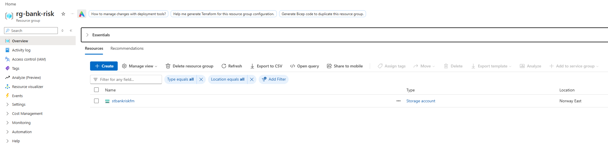
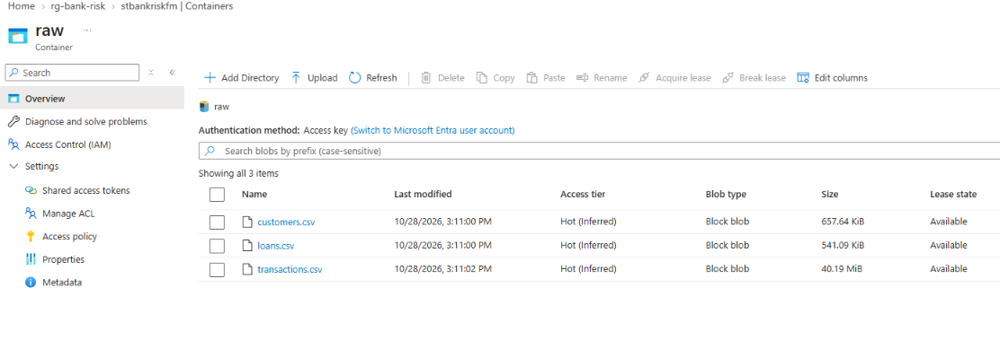

# Azure setup

This project runs on the Azure free credit, which ends in early November 2026. After that the resources are switched off, so I keep screenshots and short notes here.

## Day 1 (28 October 2026)

### Resource group

A separate resource group, `rg-bank-risk`, in Norway East. I keep each project in its own resource group, so resources and costs don't mix with my other project.

### Storage account

Storage account `stbankriskfm`. Hierarchical namespace is enabled, which makes it Azure Data Lake Storage Gen2 with real folders. Anonymous access is off, soft delete keeps deleted files for 7 days, and it uses locally redundant storage (LRS), the cheapest option.

My first try had hierarchical namespace switched off. I caught it on the review page and turned it on before creating the account.

### Raw container

The `raw` container with the three CSV files from the notebook: customers, loans and transactions (about 40 MiB).

## Day 2 (29 October 2026)

### SQL server and database

A logical SQL server, `sql-bank-risk-fm`, and a database, `sqldb-bank-risk`, in the same resource group. The server holds the login and network rules, and the database holds the data.

Both are in Sweden Central, because my free subscription had no SQL capacity in Norway East. The storage account stays in Norway East. The data is small (about 42 MB), so copying it between the two regions costs almost nothing.

- Azure SQL Database free offer: serverless, General Purpose, 2 vCores, 32 GB. Overage billing is disabled, so when the monthly free limit is used up, the database pauses instead of charging.
- Microsoft Entra-only authentication, so no SQL passwords exist.
- The server firewall allows only my own IP address, added from the Query editor.

### Tables

Three empty tables, created with `sql/01_create_tables.sql`. Primary keys stop duplicate IDs, and foreign keys from `loans` and `transactions` to `customers` reject rows for customers that don't exist. Money uses `DECIMAL(12,2)`, and `defaulted` is `BIT` (0 or 1).

The tables will be filled by Azure Data Factory on Day 3.
