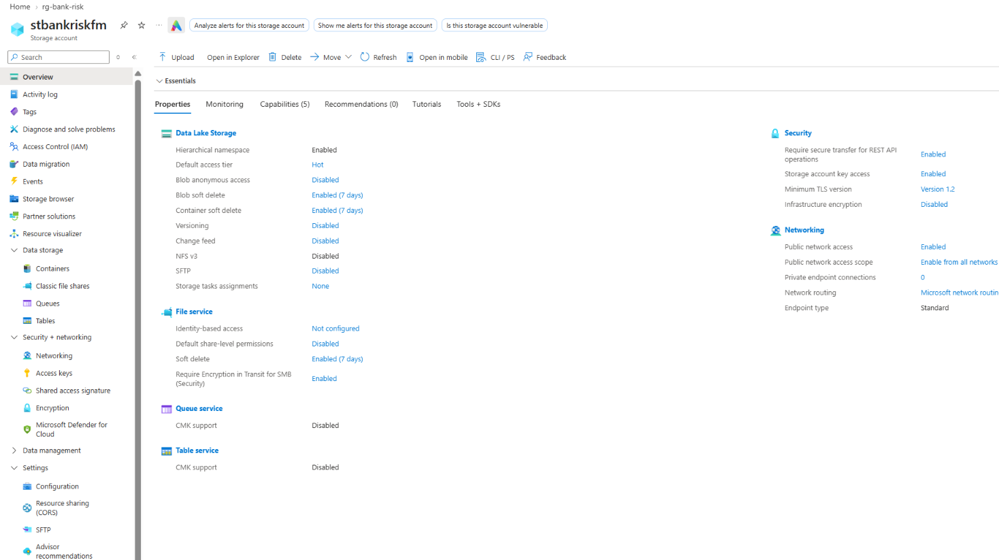
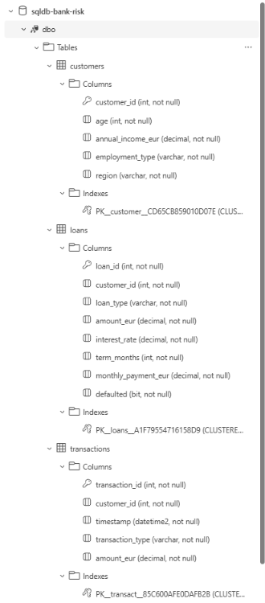
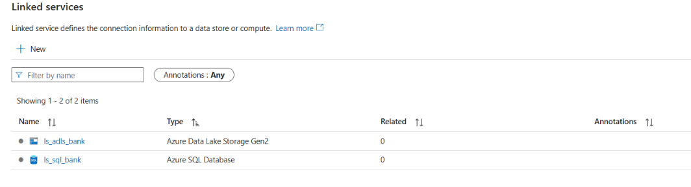
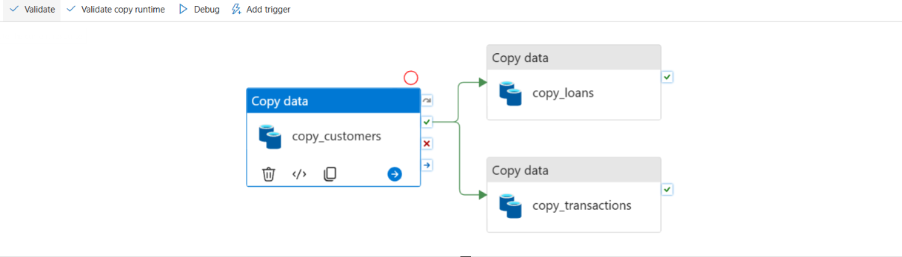
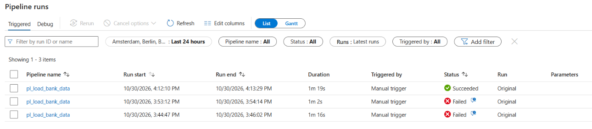
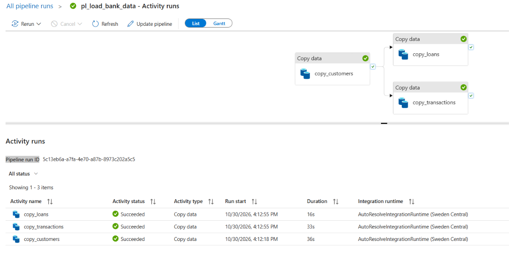
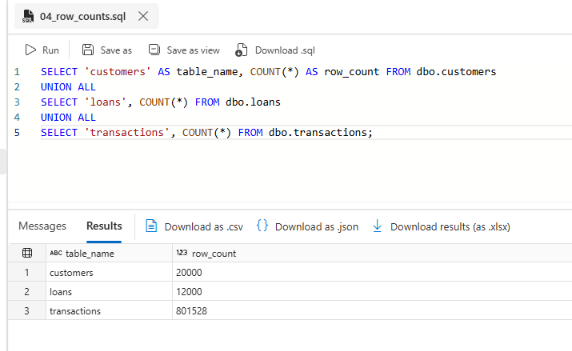
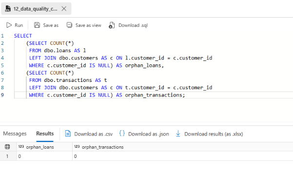

# Azure setup

Screenshots and notes of the Azure part of the project. It ran on the Azure free credit, which ended in early November 2026, so the resources are now switched off.

## Resources

| Resource | Name | Region |
|---|---|---|
| Resource group | `rg-bank-risk` | Norway East |
| Storage account (Data Lake Storage Gen2) | `stbankriskfm` | Norway East |
| SQL server | `sql-bank-risk-fm` | Sweden Central |
| SQL database | `sqldb-bank-risk` | Sweden Central |
| Data factory | `adf-bank-risk-fm` | Norway East |

The project has its own resource group, so its resources and costs stay separate from my other project. The database is in Sweden Central because the free subscription had no SQL capacity in Norway East. The data is small (about 42 MB), so copying it between the two regions costs almost nothing.

## Storage account

- Hierarchical namespace is enabled, which makes it Azure Data Lake Storage Gen2 with real folders.
- Anonymous access is off, and soft delete keeps deleted files for 7 days.
- Locally redundant storage (LRS), the cheapest option.
- Shared-key access was left at the Azure default. The pipeline never used it; in production I would disable it.

The `raw` container holds the three CSV files from the notebook: customers, loans and transactions (about 40 MiB).

## SQL database

- Azure SQL Database free offer: serverless, General Purpose, 2 vCores, 32 GB. Overage billing is disabled, so the database pauses instead of charging when the monthly free limit is used up.
- Microsoft Entra-only authentication, so no SQL passwords exist.
- The server firewall allows Azure services, so Data Factory can reach the server, and my own IP address for the Query editor. Logging in still needs an Entra identity with a user in the database.
- Three tables (`sql/01_create_tables.sql`). Primary keys block duplicate IDs, and foreign keys from `loans` and `transactions` to `customers` reject rows for customers that don't exist. Money uses `DECIMAL(12,2)`.
- `defaulted` started as `BIT` and was changed to `TINYINT` in `sql/03_loans_defaulted_to_tinyint.sql` (see Runs below).

## Data Factory and access

Data Factory signs in with its system-assigned managed identity, so no keys or passwords are stored:
- On the storage account it has only the Storage Blob Data Reader role, so it can read the files but not change them.
- In the database it has a user created from Microsoft Entra with only the `db_datareader` and `db_datawriter` roles (`sql/02_create_adf_user.sql`). It can add and remove rows, but it can't create or drop tables.

- Two linked services: `ls_adls_bank` for the data lake and `ls_sql_bank` for the database, both using the managed identity. The SQL connection uses mandatory encryption.
- Six datasets: one for each CSV file and one for each table. The CSV datasets read every column as text, and the copy converts them to the table types.

## Pipeline

- `pl_load_bank_data` has three copy activities. `copy_customers` runs first, and only if it succeeds do `copy_loans` and `copy_transactions` run, in parallel, because of the foreign keys.
- A pre-copy script on `copy_customers` empties the tables in reverse foreign-key order (transactions, loans, customers), so a rerun gives the same result instead of duplicate keys.
- The full definition is in `adf/pl_load_bank_data.json`. Git integration in Data Factory was not set up, so the definition was saved by hand.

## Runs

It took three runs:
1. **Failed:** "Server provided routing information, but timeout already expired". The serverless database had paused and was still waking up. Fix: 2 retries with a 60-second interval on `copy_customers`.
2. **Failed on loans:** Data Factory couldn't convert the text `0` in `defaulted` to a Boolean for the `BIT` column. Fix: I kept the raw file unchanged and changed the column to `TINYINT`.
3. **Succeeded** in 1 minute 19 seconds.

## Row counts

`sql/04_row_counts.sql`: 20,000 customers, 12,000 loans and 801,528 transactions, the same as the source files. After three runs there are still no duplicates, thanks to the pre-copy script.

## Data-quality checks

The code and results are in `sql/05_data_quality_checks.sql`:
- Defaults: 732 of the 12,000 loans, the same as in the generated data.
- Loans: no zero or negative amounts, rates, terms or monthly payments, and no interest rate of 100% or more.
- Customers: no one under 18 or over 100, and no zero or negative income.
- Transactions: amounts from 0.19 to 49,754.48 EUR, dated 1 April to 30 September 2026.
- Loans and transactions without a customer: none.

There is no separate check for empty values or duplicate IDs, because the columns are `NOT NULL` and the primary keys already block them.
